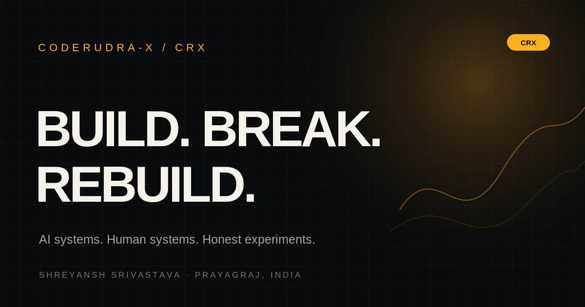

<div align="center">
  

  <h1>CODERUDRA-X</h1>
  <h3>BUILD. BREAK. REBUILD.</h3>
  <p><strong>AI systems. Human systems. Honest experiments.</strong></p>
  <p>A portfolio and build log by <strong>Shreyansh Srivastava</strong> — CRX.</p>

  <p>
    <a href="https://linkedin.com/in/coderudrax"></a>
    <a href="https://github.com/CODERUDRA-X"></a>
    <a href="https://x.com/coderudrax"></a>
    
    
    
  </p>

  <p>
    <a href="#-run-it-locally">Run locally</a> ·
    <a href="#-the-experience">Explore the experience</a> ·
    <a href="#-project-architecture">Architecture</a> ·
    <a href="./FILL_CHECKLIST.md">Launch checklist</a>
  </p>
</div>

---

## The point

> **I build AI systems, and I build the people who build them.**

CODERUDRA-X is not meant to be a stack of polished claims. It is a field log: the systems I have worked on, the communities I have tried to build, the experiments that did not land, and the next things I want to test.

The site is also a self-directed hiring pitch for a potential **Wispr Flow India growth** conversation. It is an independent portfolio concept—not an official Wispr Flow website, campaign, or representation of the company.

**The rule behind the experience:** show the work, show the miss, explain the learning, and label a proposal as a proposal. No invented outcomes. No fake live metrics.

## The experience

The portfolio is organised into eight routes. Each page has one job; the navigation stays deliberately small.

| Route | What you will find |
|---|---|
| `/#/` | **Home** — voice-first identity, shader-led hero, Growth Control Room, owner-supplied metrics, and a route into the build log. |
| `/#/thread` | **The Thread** — five chapters: Origin, Builder, Community, Scale, and Now. Wins and setbacks share the same format. |
| `/#/builds` | **Builds** — AEGIS-SWARM, VidyutNetra AI, and Vanshika, each with a project-specific explainer interaction. |
| `/#/community` | **Community** — the 600+ Vibe Coding Hack and the 2-person Brand Ideathon, shown without hiding the contrast. |
| `/#/campaigns` | **Campaigns** — three proposed India growth experiments, with goals, channels, measures, and first-seven-day actions. |
| `/#/voice` | **Voice Receipts** — a raw-to-clean comparison interface reserved for a real spoken excerpt and its faithful edit. |
| `/#/ask` | **Ask Me** — six hiring questions with pre-written, source-grounded draft answers. No AI API is called. |
| `/#/contact` | **Contact** — education, internship logistics, and verified public profile links. |

### The signature interactions

- **Growth Control Room** — choose between Build by Voice, Hinglish Demo Clips, and a Campus Ambassador Loop. Each selection reveals its proposed goal, distribution channel, success signal, and first-week sequence. These are plans, not executed campaign results.
- **AEGIS-SWARM** — an interactive visual that explains agents disagreeing and moving toward consensus. It is an explainer, not a live connection to a deployed multi-agent system.
- **VidyutNetra AI** — a procedural power-line inspection scene with a reveal slider and illustrative detection boxes. The displayed 99.2% damage-recall figure is owner-supplied; the visual does not run model inference.
- **Vanshika** — a small client-side Hinglish time parser. It handles a limited vocabulary such as `ghante`, `minute`, `kal`, `parso`, `baad`, `subah`, `shaam`, and `raat`. It is rule-based, not an LLM or general natural-language engine.
- **Community room-fill** — a visual comparison of the supplied 600+ attendance figure and the 2-person Ideathon turnout. The contrast is intentional: the miss belongs in the story too.
- **CRX Ignition Sequence** — a short identity intro built from canvas particles, orbital geometry, a CRX core reveal, and the Build. Break. Rebuild. wordmark. It includes a skip action and a reduced-motion path.

## Built with

| Layer | Tools |
|---|---|
| App | React 19, TypeScript 5.9, Vite 7 |
| Routing | React Router 7 with `HashRouter` for static-host compatibility |
| Styling | Tailwind CSS 4 via the Vite plugin, authored CSS, and CSS custom properties |
| Motion | Motion, GSAP, ScrollTrigger, and Lenis |
| Graphics | Three.js, custom GLSL, Canvas 2D, procedural SVG, and CSS fallbacks |
| Icons | Lucide React |
| Typography | Space Grotesk, Inter, and DM Mono |
| Open Graph asset | Build-time SVG generation and PNG rendering with Sharp |

No UI kit controls the visual identity. Layout, interaction primitives, backgrounds, and project explainers are authored for this site.

## Run it locally

### Requirements

- Node.js and npm installed.
- A modern browser. WebGL and browser speech capabilities vary by device and browser.

### Install and start

```bash
npm install
npm run dev
```

Open the local URL printed by Vite, usually `http://localhost:5173`.

### Production build

```bash
npm run build
npm run preview
```

The build command runs these steps in order:

1. `npm run og` — generates `public/og-image.svg` and `public/og-image.png`.
2. `tsc -b` — checks the TypeScript project references.
3. `vite build` — writes the static production site to `dist/`.

To regenerate only the social preview image:

```bash
npm run og
```

## Deploy as a static site

This project does not require a server, database, environment variables, or serverless functions.

### GitHub Pages

1. Push the project to your GitHub repository.
2. Configure a GitHub Pages workflow or deployment action to publish the `dist/` directory after `npm run build`.
3. Keep `HashRouter` enabled. Internal pages use hash routes such as `/#/builds`, so the host does not need route-rewrite rules.
4. Keep the Vite `base` setting compatible with the repository path. It is currently `./` for relative asset paths.
5. After deployment, verify that the Open Graph image resolves from the final site URL.

### Netlify or Vercel

- **Build command:** `npm run build`
- **Publish directory:** `dist`
- **Environment variables:** none required

Use the static-site deployment option. No backend runtime is expected.

## Project architecture

```text
coderudra-x-site/
├── public/
│   ├── og-image.svg              # Editable social-preview source
│   └── og-image.png              # Generated 1200 × 630 preview
├── scripts/
│   └── generate-og.mjs           # Build-time Open Graph generation
├── src/
│   ├── components/
│   │   ├── BuildVisuals.tsx      # AEGIS, VidyutNetra, Vanshika explainers
│   │   ├── GrowthControlRoom.tsx # Interactive growth proposal selector
│   │   ├── HeroField.tsx         # Lazy-loaded Three.js / GLSL hero
│   │   ├── Preloader.tsx         # CRX Ignition Sequence
│   │   ├── SiteShell.tsx         # Header, menu, footer, global shell
│   │   └── ...                   # Small reusable UI primitives
│   ├── content/
│   │   └── site.ts               # Typed content, metrics, campaigns, Q&A, fills
│   ├── lib/
│   │   └── hinglishParser.ts     # Deterministic client-side time parser
│   ├── motion/
│   │   ├── generators.tsx        # Seeded procedural SVG backgrounds
│   │   ├── useSmoothScroll.ts    # Lenis / GSAP scroll integration
│   │   └── ...                   # Motion primitives
│   ├── pages/                    # Eight route-level pages
│   ├── App.tsx                   # HashRouter and lazy route loading
│   ├── main.tsx                  # App entry point
│   └── styles.css                # Design tokens and authored styles
├── CONTENT.md                    # How to edit site content
├── FILL_CHECKLIST.md             # Owner information still required
├── PAGE_NOTES.md                 # How to present each page
├── package.json
└── README.md
```

### Content is separate from presentation

Most editable copy and structured data live in `src/content/site.ts`. Page components render those typed objects. Update the content source first; avoid hardcoding another copy of the same metric or campaign inside a component.

- Read [`CONTENT.md`](./CONTENT.md) before changing copy or metrics.
- Work through [`FILL_CHECKLIST.md`](./FILL_CHECKLIST.md) before publishing.
- Use [`PAGE_NOTES.md`](./PAGE_NOTES.md) when presenting the portfolio to someone else.

## Design and engineering decisions

### Visual system

- Near-black base: `#0a0b0d`.
- Amber accent: `#ffb020`.
- Large, compressed display typography; restrained body copy; mono labels for system metadata.
- Procedural backgrounds are generated in code with page-specific seeds.
- Pointer effects, spotlights, orbital geometry, and shader movement reinforce the site's themes: voice, systems, consensus, and iteration.

### Performance intent

- Route-level pages are lazy-loaded.
- The Three.js hero is lazy-loaded separately.
- The hero renderer caps device pixel ratio and pauses drawing when the canvas is offscreen or the document is hidden.
- The intro uses a lightweight Canvas 2D particle field and reduces particle count on narrow screens.
- DOM movement is kept mostly to transform and opacity; visual fallbacks are provided where WebGL is unavailable.

These are implementation choices, **not a measured Lighthouse result**. No 90+ performance score or sustained 60 fps claim is made here until it has been tested on target devices.

### Accessibility intent

- `prefers-reduced-motion` is respected by the scrolling and visual systems.
- The site includes a skip-to-content link, keyboard-operable navigation, visible focus styles, and Escape handling for overlays and the intro.
- Interactive project controls use native buttons, inputs, and range sliders where appropriate.

A real screen-reader and keyboard audit is still part of the release checklist. Accessibility intent is not a substitute for testing.

## Accuracy, privacy, and demo boundaries

This portfolio deliberately separates **evidence**, **illustration**, and **proposal**.

- The figures in the metrics strip are supplied portfolio figures. They are not live counters or independently verified by this site.
- Growth Control Room and Campaigns show proposed experiments. They must not be described as campaigns already executed or as measured Wispr Flow results.
- Project visuals explain an idea or interaction. They do not connect to production AI models or claim live inference.
- The Vanshika parser supports a small documented rule set and should reject or explain inputs outside that set.
- Voice Receipts must contain a real raw excerpt and a faithful edited version before they are presented as evidence. The current dashed fill chips are intentional placeholders.
- Missing facts are represented by visible fill chips and tracked in `FILL_CHECKLIST.md`; do not replace them with invented details.
- No login, application backend, paid API, analytics SDK, or tracking pixel is included in the app. Google Fonts are requested from Google Fonts in the current HTML head.

## Before calling it finished

The site is structurally built, but it is not ready to be treated as a final hiring submission until the owner completes the evidence and release checks.

- [ ] Fill all owner-only fields in `FILL_CHECKLIST.md`.
- [ ] Add the exact public AEGIS-SWARM and Vanshika repository URLs.
- [ ] Confirm the Innovate 2026 title, responsibilities, and scope.
- [ ] Explain how the Vibe Coding Hack reached 600+ attendees.
- [ ] Add the actual learning and next target from the 2-person Brand Ideathon.
- [ ] Add a real paired voice excerpt and its edited version—or remove the receipts section.
- [ ] Confirm availability and the Bangalore relocation plan.
- [ ] Check every route at mobile, tablet, laptop, and wide-desktop widths.
- [ ] Test keyboard-only navigation, reduced motion, and browser fallbacks.
- [ ] Run `npm run build` and resolve all TypeScript and console errors.
- [ ] Test the deployed Open Graph preview and run Lighthouse on a real mobile profile.

## Reference notes

The project takes technique inspiration—not copied assets or styling—from Motion Primitives, Haikei, K95, and HAOQI. The design system, procedural graphics, project explainers, and interaction components are implemented for CODERUDRA-X.

---

<div align="center">
  <strong>CRX / PRAYAGRAJ, INDIA</strong><br />
  <sub>BUILD THE THING. BREAK THE ASSUMPTION. REBUILD WITH EVIDENCE.</sub><br /><br />
  <a href="https://linkedin.com/in/coderudrax">LinkedIn</a> ·
  <a href="https://github.com/CODERUDRA-X">GitHub</a> ·
  <a href="https://x.com/coderudrax">X</a> ·
  <a href="https://kaggle.com/coderudrax">Kaggle</a>
</div>
